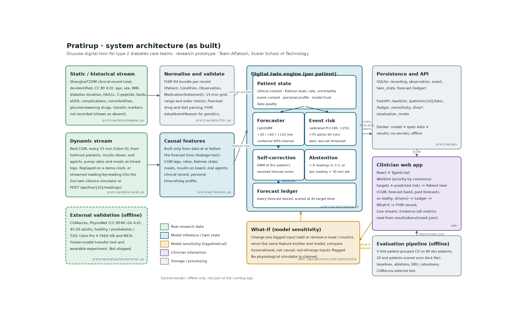
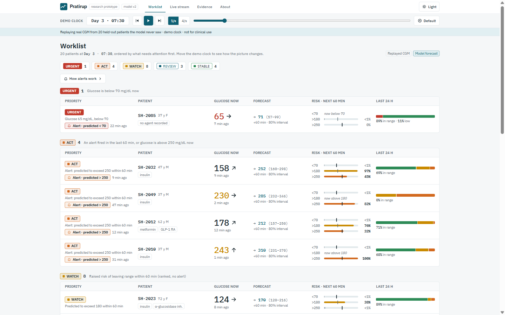
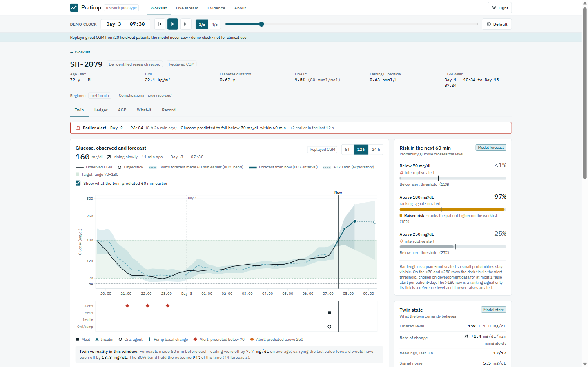
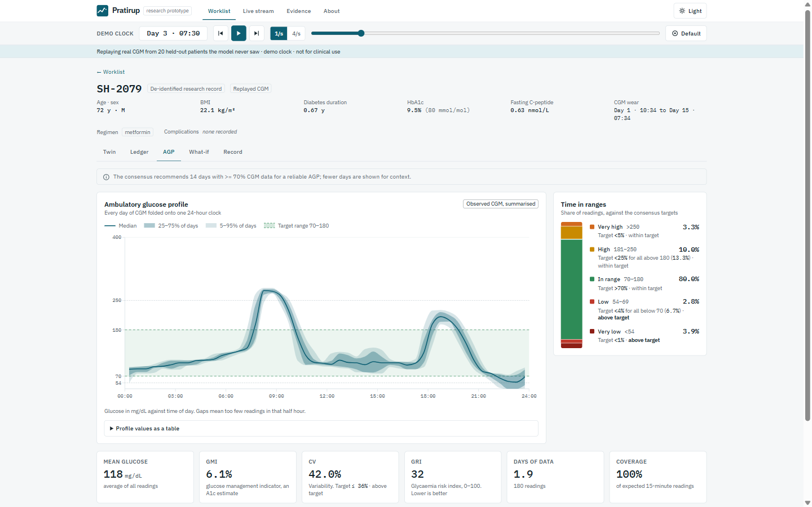

# Pratirup

**A glucose digital twin for type 2 diabetes care teams.**

[](https://github.com/Spiritsfuse/pratirup/actions/workflows/ci.yml)
[-FF0000?style=flat&logo=youtube&logoColor=white)](https://youtu.be/VzApuuSp6CA)
[-0D5F73?style=flat&logo=adobeacrobatreader&logoColor=white)](docs/Pratirup_Presentation.pdf)
[-2E8B57?style=flat)](docs/architecture.pdf)

Pratirup (प्रतिरूप, "counterpart") keeps a continuously updated model of each person with type 2 diabetes. It combines their clinical record with their CGM stream and logged medication and meals. For each patient it:

- forecasts glucose 30–60 minutes ahead with measured uncertainty;
- raises a single, rate-limited alert stream for imminent hypo- and severe hyperglycaemia;
- scores every forecast against what actually happened.

> **Research prototype. Not a medical device.** Outputs are experimental. They were evaluated retrospectively on open research data and must be interpreted by a qualified clinician. Pratirup does not diagnose, prescribe or recommend treatment changes.

## Submission checklist

| Required item | Where in this README |
|---|---|
| Team details | [Team details](#team-details) |
| College / incubator information | [College / incubator information](#college--incubator-information) |
| Project title | [Project title](#project-title) |
| Problem statement | [Problem statement](#problem-statement) |
| Healthcare use case | [Healthcare use case](#healthcare-use-case) |
| Technical stack | [Technical stack](#technical-stack) |
| AI/ML model or framework details | [AI/ML model and framework details](#aiml-model-and-framework-details) |
| Demo video (unlisted YouTube) | [Demo video](#demo-video) · [▶️ Watch (20 min)](https://youtu.be/VzApuuSp6CA) |
| Open-source licence details | [Open-source licence details](#open-source-licence-details) |
| Architecture diagram (PDF/PPT) | [Architecture diagram](#architecture-diagram): [`docs/architecture.pdf`](docs/architecture.pdf) |
| Presentation (PDF/PPT) | [Presentation](#presentation): [`docs/Pratirup_Presentation.pdf`](docs/Pratirup_Presentation.pdf) · [`.pptx`](docs/Pratirup_Presentation.pptx) |
| All files and links publicly accessible | Every artefact is a file in this public repository. Nothing needs a login or a request. |

---

## Demo video

<div align="center">
  <a href="https://youtu.be/VzApuuSp6CA" target="_blank" rel="noopener noreferrer">
    
  </a>
  <p>
    <a href="https://youtu.be/VzApuuSp6CA" target="_blank" rel="noopener noreferrer">
      
    </a>
  </p>
  <p><em>▶️ <strong><a href="https://youtu.be/VzApuuSp6CA">Click above to watch the full demonstration (20 min) on YouTube</a></strong></em></p>
</div>

A full 20-minute demonstration and presentation of Pratirup by Team Aflatoon (Scaler School of Technology) for the **Happiest Health Digital Twin Challenge 2026**.

The demonstration covers the clinical problem in India, real-data patient fusion (ShanghaiT2DM), a leak-free evaluation protocol, a live walkthrough of all 8 clinician screens, empirical results (26% MAE error reduction, Parkes A+B safety, noise robustness, alert consolidation, and US external validation), and transparent limitations.

### Video walkthrough chapters

| Time | Section | What is shown |
|---|---|---|
| **[0:00](https://youtu.be/VzApuuSp6CA?t=0)** | **Part 1 · Problem & Clinical Vision** | India's 101M diabetes burden; why current CGM tools (Dexcom, LibreView) are retrospective or patient-only; the gap for a clinician-facing twin combining records with live streams; 6-part patient state and single-container architecture |
| **[7:00](https://youtu.be/VzApuuSp6CA?t=420)** | **Part 2 · Data, Evaluation & Models** | Real linked records + CGM in ShanghaiT2DM (no synthetic shortcuts); strict 80/20 patient-level split; 88 past-only features; LightGBM multi-horizon forecasts (+30, +60, +120 min); conformalized 80% intervals; TreeSHAP explanations; noise-robust training |
| **[10:25](https://youtu.be/VzApuuSp6CA?t=625)** | **Part 3 · Live System Walkthrough** | **Interactive clinician app demonstration:**<br>• `10:25` **Worklist:** Multi-patient triage ranking on shared demo clock<br>• `11:25` **Dynamic Triage:** Clock ticks every 15 min with rate-limited alerts<br>• `11:55` **Patient Twin (SH-2079):** Forecast bands, past forecast comparison overlay, risk scores, Kalman speed/noise state, TreeSHAP feature attributions<br>• `13:15` **Time Travel:** Replay past moments without future leakage<br>• `13:35` **AGP Report:** International consensus standard Ambulatory Glucose Profile (TIR, GMI, GRI)<br>• `14:10` **Forecast Ledger:** Continuous per-patient self-scoring of accuracy<br>• `14:40` **What-if Analysis:** Model sensitivity to meal/insulin adjustments (associational disclaimer)<br>• `15:10` **Clinical Record:** Linked EHR context & ABDM-compliant FHIR R4 resources<br>• `15:30` **Live Stream:** Device simulator streaming held-out readings via ingestion API<br>• `16:05` **Evidence Page:** In-app inspection of all locked experimental benchmarks |
| **[16:50](https://youtu.be/VzApuuSp6CA?t=1010)** | **Part 4 · Experimental Results** | 60-min MAE 14.90 vs 20.07 mg/dL (26% reduction); 100% in Parkes zones A+B; comparisons vs GRU and zero-shot Chronos-Bolt foundation model; honest ablation (personal history helps most; EHR/wearables don't sharpen short-term MAE); 81% conformal coverage; alerts down from 7.9 to 1.9/day catching 83% of lows; external validation on US CGMacros cohort |
| **[19:10](https://youtu.be/VzApuuSp6CA?t=1150)** | **Part 5 · Limitations & Regulatory Roadmap** | Transparent discussion of Chinese vs Indian cohort, retrospective bounds, SaMD classification under CDSCO Medical Device Rules 2017, DPDP Act 2023, and planned Indian clinic prospective pilot |

---

## Team details

| | |
|---|---|
| Team | **Aflatoon** (Unstop team ID: `pratyushm704`) |
| Members | Dhruv Sharma · [@Spiritsfuse](https://github.com/Spiritsfuse)<br>Pratyush Mishra · [@PratyushMishra-2nd](https://github.com/PratyushMishra-2nd)<br>Anushika Chauhan · [@Anushika06](https://github.com/Anushika06) |
| Challenge | Happiest Health Digital Twin Challenge 2026 |
| Submission name | `Aflatoon_Scaler School of Technology` |

## College / incubator information

**Scaler School of Technology**, Bengaluru, Karnataka, India. All three members are full-time students.

## Project title

**Pratirup: a glucose digital twin for type 2 diabetes care teams**

## Problem statement

**In one sentence.** Clinicians reviewing CGM data for people with type 2 diabetes see where glucose *has been*, separately from the patient's clinical record. Pratirup keeps a continuously updated model of each patient that combines both. It forecasts the next 30–60 minutes, warns of imminent dangerous excursions with measured uncertainty, and scores itself against what actually happens.

**Why it matters**

- ICMR-INDIAB-17 estimates that 101 million people in India have diabetes and 136 million have prediabetes ([Anjana et al., *Lancet Diabetes Endocrinol* 2023](https://www.thelancet.com/journals/landia/article/PIIS2213-8587(23)00119-5/fulltext)).
- Only 36.3% of people with diagnosed diabetes reach HbA1c < 7% ([ICMR-INDIAB-13, 2022](https://www.thelancet.com/journals/landia/article/PIIS2213-8587(22)00072-9/abstract)).
- The international consensus sets CGM targets of < 4% of time below 70 mg/dL and < 5% above 250 mg/dL ([Battelino et al., *Diabetes Care* 2019](https://pmc.ncbi.nlm.nih.gov/articles/PMC6973648/)).

**What is missing**

- Clinician CGM tools such as LibreView, Dexcom Clarity and Glooko are retrospective.
- Forward-looking alerts already exist, but they are patient-facing, use CGM only and are tied to one vendor's sensor:
  - Dexcom G7 predicts lows 20 min ahead.
  - Medtronic alerts look up to 60 min ahead.
  - Roche Accu-Chek SmartGuide predicts lows 30 min ahead and gives a 2-hour trajectory.
- **Forecasting is not our novelty, and we do not claim it is.** What we did not find is a clinician-facing view that:
  - uses the clinical record;
  - ranks a panel of patients by imminent risk;
  - keeps alerts to a usable rate;
  - explains each forecast;
  - publishes a running, per-patient score of its own forecasts.

## Healthcare use case

**Setting.** A diabetes care team (diabetologist, diabetes educator or remote-monitoring coach) runs a 14-day connected or professional CGM programme for adults with type 2 diabetes.

**Workflow**

1. The twin updates its state on every 15-minute reading and every logged meal or dose.
2. The **worklist** ranks patients by consensus targets and predicted risk: low now, alerted, raised risk, then time in range.
3. One **alert stream** per patient fires only for predicted glucose < 70 or > 250 mg/dL within 60 min, at most once an hour (a predicted low may override). Thresholds were set for ≤ 1 false alert per patient-day on development data.
4. The educator opens the patient twin and sees:
   - the forecast and its uncertainty;
   - why the model expects it;
   - how accurate the twin has been for this person.
5. At the visit, the clinician reviews the **AGP** report and replays any moment to see what the twin expected and what happened.

**Outputs**

- **Primary:** glucose at +30 and +60 min with an 80% prediction interval. +120 min is exploratory.
- **Secondary:** calibrated probability of falling below 70, rising above 180, or rising above 250 mg/dL within 60 min, each confirmed by ≥ 2 consecutive readings.

**Boundaries.** Clinicians make every decision. Whether this improves outcomes is a hypothesis that needs a prospective study.

## What makes this a digital twin

Each patient has a **persistent state** that updates on **every reading and logged event**.

| State block | Contents | Observed or estimated |
|---|---|---|
| Clinical context | Age, sex, BMI, diabetes duration, HbA1c, C-peptide, lipids, eGFR, complications, drug classes (FHIR R4) | Observed |
| Glycaemic state | Glucose level, rate of change and their uncertainty (Kalman filter; uncertainty grows during sensor gaps) | Estimated |
| Event context | Time since meals and fast insulin, insulin on board, oral agents, pump basal rate | Observed |
| Personal profile | Time in range so far; what this person's glucose usually does at this time of day | Estimated |
| Model trust | Running mean of this patient's own resolved forecast errors (the **forecast ledger**) | Estimated |
| Data quality | Readings in the last 3 h, signal roughness (noise). The twin **abstains** rather than guess. | Observed |

**Update loop** (`pratirup/twin/engine.py`), on each reading:

1. Validate the reading.
2. Run the Kalman update.
3. Resolve the forecasts that are due and update model trust.
4. Rebuild the features from the past only.
5. Forecast, with intervals.
6. Compute risk and apply the alert policy.
7. Write to the ledger.
8. Re-rank the worklist.

The streaming twin and the batch replay that the benchmark scores share every formula. [`tests/test_twin_parity.py`](tests/test_twin_parity.py) requires identical outputs reading by reading, including the alerts.

**What-if** changes one logged input (a meal or a fast-insulin dose) and reruns the same model. It is labelled **model sensitivity: associational, not causal**.

## Technical stack

| Layer | Choice | Why |
|---|---|---|
| Forecasting and risk | LightGBM 4.7 (point, quantile and binary models), scikit-learn (isotonic calibration, ridge) | Small tabular-temporal data, exact per-feature attributions, CPU only |
| Comparisons (offline) | PyTorch 2.14 (GRU); Amazon Chronos-Bolt (zero-shot foundation model) | Evidence that the served model is not leaving accuracy on the table |
| Uncertainty | Conformalised quantile regression (CQR) | Coverage checked on unseen patients |
| Twin state | Kalman filter (NumPy), exponentially weighted residual memory | Explicit state with uncertainty |
| Interoperability | FHIR R4 (Patient, Condition, Observation, MedicationStatement) | Same record model as India's ABDM |
| Backend | Python 3.12, FastAPI, SQLite | One process, one file, zero setup |
| Frontend | React 18, TypeScript (strict), Vite, Tailwind CSS, Recharts | Typed, fast, charts with explicit units |
| DevSecOps | Docker (non-root, read-only, capabilities dropped), GitHub Actions CI (tests, `pip-audit`, `npm audit`, Docker smoke test, Trivy), Dependabot | Reproducible and safe by default |

No external API, no LLM, no GPU and no secret is used anywhere.

## AI/ML model and framework details

**Served model.** LightGBM forecasters of the glucose change at +30, +60 and +120 min.

- **Inputs.** 88 inputs built only from data at or before the forecast time:
  - CGM history and Kalman state;
  - signal roughness;
  - meals, insulin on board, oral agents and pump rate;
  - the clinical record;
  - the patient's own time-of-day profile.
- **Uncertainty.** Conformalised quantile models give an 80% interval.
- **Event risk.** Isotonic-calibrated classifiers estimate the probability of each event within 60 min.
- **Per-patient correction.** An online correction learned from the patient's own forecast errors.
- **Explanations.** TreeSHAP shows why each forecast was made.
- **Training (v2).** Every model also learns from noise-augmented copies of the training recordings, so accuracy holds up when the sensor is noisy.

**Compared on the same patients:**

- last value carried forward;
- a Kalman trend;
- ridge autoregression;
- a tuned GRU sequence network;
- a LightGBM ablation ladder (CGM → + logs → + clinical record → + personal history);
- Amazon's Chronos-Bolt foundation model, zero-shot.

**Protocol (fixed before testing)**

- **Split.** 80 development patients (5 folds, split by patient) and 20 test patients.
- **Development-only choices.** Every choice was made on development patients:
  - Kalman parameters;
  - hyperparameters;
  - GRU configuration;
  - conformal adjustment;
  - calibration;
  - alert thresholds;
  - adopting noise augmentation, under a rule written before the experiment.
- **Early stopping** used held-out development patients only.
- **Test scoring.** The test set is scored behind a lock file. v1 was scored once. v2 was scored once more, with the reason logged in [`results/runs.jsonl`](results/runs.jsonl). v1 results are kept unchanged in [`results/v1/`](results/v1/).
- **Leakage test.** [`tests/test_leakage.py`](tests/test_leakage.py) proves that no feature sees the future.

**Metrics**

- **Forecasts:** MAE, RMSE, bias, MARD, error by glucose band, the Parkes type-2 error grid, and per-patient mean ± SD.
- **Intervals:** coverage and width.
- **Alerts** (per episode): sensitivity, sensitivity with ≥ 30 min warning, PPV, false alerts per patient-day, lead time and AUPRC.
- **Also:** calibration, robustness, subgroups, external validation, and patient-level bootstrap 95% CIs.

**Headline (v2, 20 unseen patients).** The full tables follow under [Results](#results).

- **60-min error:** 14.90 mg/dL, against 20.07 for last value carried forward.
- **Intervals:** 81% coverage of the stated 80% interval.
- **Under sensor noise (SD 10):** 30-min error 13.5, against 15.1 for last value.
- **Alerts:** about 1.9 per patient-day. 83% of hypoglycaemia episodes and 78% of > 250 mg/dL episodes are caught.
- **External cohort (US, different sensor):** T2D 60-min error 17.2, against 22.4 for last value.

Details: [`docs/MODEL_CARD.md`](docs/MODEL_CARD.md) · [`docs/DATA_CARD.md`](docs/DATA_CARD.md).

## Architecture diagram



PDF: [`docs/architecture.pdf`](docs/architecture.pdf), generated from code by [`docs/make_architecture.py`](docs/make_architecture.py). Every box is a module in this repository.

## Presentation

- PDF: [`docs/Pratirup_Presentation.pdf`](docs/Pratirup_Presentation.pdf)
- PowerPoint: [`docs/Pratirup_Presentation.pptx`](docs/Pratirup_Presentation.pptx)
- Demo video walkthrough: [Watch the presentation and software demo on YouTube (20 min)](#demo-video)

The deck is generated by [`docs/deck/build_deck.js`](docs/deck/build_deck.js), which reads every number from `results/benchmark.json`.

## Open-source licence details

- **Code:** [Apache-2.0](LICENSE).
- **Data** keeps its own licences ([`DATA_LICENSES.md`](DATA_LICENSES.md)):
  - ShanghaiT2DM is CC BY 4.0. A processed copy is included with attribution.
  - CGMacros is CC BY-NC-SA 4.0. It is not included and is downloaded on demand for external validation only.
- **Models:** the shipped models are trained on ShanghaiT2DM only.
- **Benchmark-only dependencies:** Chronos-Bolt weights (Apache-2.0) are downloaded at benchmark time and are not shipped.

---

## Results

<!-- RESULTS:START -->
All numbers below are generated from [`results/benchmark.json`](results/benchmark.json) by `scripts/update_readme_results.py`.

- **Test set:** 20 held-out patients.
- **Model:** v2, scored 2026-10-21T17:08:08.
- **v1 results:** kept in [`results/v1/`](results/v1/). The reason for the re-evaluation is logged in [`results/runs.jsonl`](results/runs.jsonl).
- **Confidence intervals:** patient-level bootstrap.

#### v1 → v2

| | v1 | **v2 (current)** |
|---|---|---|
| MAE 30 min (mg/dL) | 8.64 | **8.84** |
| MAE 60 min (mg/dL) | 14.76 | **14.90** |
| MAE 120 min (mg/dL) | 20.33 | **20.49** |
| 80% interval coverage, 60 min | 80.9% | **81.1%** |
| MAE 30 min with SD-10 random sensor noise (last value: 15.1) | 19.6 | **13.5** |
| Alerts per patient-day | 7.9 | **1.9** |
| Alert design | three independent streams | consolidated (<70 and >250, shared cooldown) |

- v2: every LightGBM model also trains on noise-augmented copies of the development recordings, with a signal-roughness feature; clean-data MAE rises 0.8-2.4% in exchange for robustness to sensor noise (selected on development data only: results/experiments/noise_robustness_dev.json).
- v2: one consolidated alert stream per patient for predicted <70 and >250 mg/dL with a shared 60-min cooldown, thresholds set on development data for <= 1 false alert per patient-day; '>180' became a ranking signal instead of an interruptive alert.

#### Forecast accuracy (held-out patients, mg/dL)

| Model | MAE 30 min | MAE 60 min | MAE 120 min* | RMSE 60 min | Parkes A+B 60 min |
|---|---|---|---|---|---|
| Last value carried forward | 12.08 | 20.07 | 30.18 | 29.97 | 99.6% |
| Kalman damped trend | 10.84 | 19.46 | 30.84 | 29.22 | 99.7% |
| Linear autoregression (ridge) | 9.81 | 17.82 | 26.80 | 25.68 | 99.9% |
| GRU sequence network | 8.65 | 14.71 | 20.15 | 21.98 | 100.0% |
| LightGBM: CGM only | 9.26 | 16.21 | 22.96 | 23.47 | 99.9% |
| LightGBM: CGM + logs | 9.21 | 15.88 | 22.88 | 23.22 | 99.9% |
| LightGBM: CGM + logs + clinical record | 9.26 | 15.98 | 23.02 | 23.34 | 100.0% |
| **Pratirup: + personal history** | 8.84 | 14.90 | 20.49 | 21.86 | 100.0% |
| Pratirup + online self-correction | 8.83 | 14.88 | 20.48 | 21.88 | 100.0% |
| Average of LightGBM and GRU (not deployed) | 8.62 | 14.62 | 20.02 | 21.65 | 100.0% |
| Chronos-Bolt small, zero-shot foundation model | 11.32 | 18.73 | 27.69 | 28.18 | — |

\* 120 min is exploratory. The brief's "2 hours in advance" example was evaluated directly rather than assumed.

- **30 min:** -3.24 mg/dL vs last value carried forward (95% CI -3.87 to -2.62).
- **60 min:** -5.17 mg/dL vs last value carried forward (95% CI -6.30 to -4.12).
- **120 min:** -9.68 mg/dL vs last value carried forward (95% CI -11.68 to -7.99).
- Versus the tuned GRU at 60 min: 0.19 mg/dL (95% CI 0.02 to 0.35): the GRU is slightly better (about 1%, clinically negligible); Pratirup serves LightGBM for exact attributions, conformal intervals and a CPU-only runtime.
- Logs, clinical record and personal history added to CGM-only LightGBM at 60 min: -1.31 mg/dL (95% CI -1.76 to -0.85).
- Online self-correction at 60 min: -0.02 mg/dL (95% CI -0.11 to 0.07): no measurable difference.
- Per patient at 60 min (mean ± SD over the 20 test patients): MAE 16.0 ± 3.7 vs 21.5 ± 5.4 for last value; RMSE 22.7 ± 4.8.

#### Uncertainty

| Horizon | Empirical coverage (nominal 80%) | Mean width (mg/dL) |
|---|---|---|
| 30 min | 80.8% | 27.7 |
| 60 min | 81.1% | 46.7 |
| 120 min | 82.9% | 66.5 |

#### Alerts: consolidated policy (what a care team receives)

- **Scope:** one stream per patient, for predicted < 70 and > 250 mg/dL within 60 min.
- **Cooldown:** shared, 60 min. A predicted low can override it.
- **Thresholds:** set on development patients for ≤ 1 false alert per patient-day.

| Cohort | Alerts / patient-day | False alerts / patient-day | PPV | < 70 caught (≥ 30 min ahead) | > 250 caught (≥ 30 min ahead) |
|---|---|---|---|---|---|
| Development (CV) | 1.54 | 1.00 | 35.5% | 77.9% (44.6%) of 280 | 72.6% (40.1%) of 434 |
| **Held-out test** | 1.89 | 1.38 | 26.9% | 82.9% (56.6%) of 76 | 77.8% (51.9%) of 54 |
| CGMacros T2D (external) | 1.78 | 1.23 | 30.7% | 88.2% (55.9%) of 34 | 74.6% (39.4%) of 71 |

#### Per-event classifiers (each tuned alone; they feed the policy and the worklist ranking)

| Event | Scorer | Episodes | Sensitivity | ≥ 30 min warning | PPV | False alerts / day | AUPRC (prevalence) |
|---|---|---|---|---|---|---|---|
| Fall below 70 within 60 min | Pratirup calibrated classifier | 76 | 96.1% | 67.1% | 10.2% | 3.14 | 0.262 (0.011) |
|  | Rate-of-change extrapolation | 76 | 73.7% | 46.1% | 9.5% | 2.58 | 0.124 (0.011) |
| Rise above 250 within 60 min | Pratirup calibrated classifier | 54 | 100.0% | 74.1% | 16.3% | 1.35 | 0.521 (0.008) |
|  | Rate-of-change extrapolation | 54 | 98.1% | 77.8% | 12.6% | 1.79 | 0.322 (0.008) |
| Rise above 180 within 60 min | Pratirup calibrated classifier | 288 | 93.8% | 61.5% | 49.5% | 1.33 | 0.532 (0.049) |
|  | Rate-of-change extrapolation | 288 | 89.2% | 47.6% | 40.8% | 1.81 | 0.398 (0.049) |

#### Robustness (inputs perturbed, true future readings unchanged)

| Perturbation | No forecast issued† | MAE 30 min (Pratirup / last value) | MAE 60 min (Pratirup / last value) | Coverage 60 min |
|---|---|---|---|---|
| 10% of readings missing | 10.3% | 9.1 / 12.1 | 15.1 / 20.1 | 81.7% |
| 30% of readings missing | 44.2% | 9.8 / 12.1 | 15.3 / 20.0 | 82.7% |
| 1-h gap every day | 4.2% | 9.0 / 12.1 | 15.0 / 20.1 | 81.3% |
| Random noise, SD 5 mg/dL | 0.0% | 11.0 / 13.1 | 16.1 / 20.8 | 77.9% |
| Random noise, SD 10 mg/dL | 0.0% | 13.5 / 15.1 | 18.1 / 22.3 | 71.0% |
| Random noise, SD 20 mg/dL | 0.0% | 20.4 / 20.7 | 23.3 / 26.7 | 61.4% |
| Correlated noise (AR(1), rho 0.7), SD 10 mg/dL | 0.0% | 12.9 / 15.2 | 17.4 / 22.4 | 74.0% |

† Includes slots whose reading was removed and slots with < 8 readings in the last 3 h.

#### External validation: CGMacros (frozen model, different country, device and setting)

| Group (CGMacros) | People | MAE 60 min: Pratirup | GRU | Last value | Interval coverage |
|---|---|---|---|---|---|
| t2d | 14 | 17.18 | 16.75 | 22.37 | 78.2% |
| prediabetes | 16 | 14.27 | 13.96 | 16.96 | 80.7% |
| healthy | 15 | 12.46 | 11.77 | 12.47 | 79.9% |
| all | 45 | 14.60 | 14.12 | 17.19 | 79.6% |

Wearable experiment (inside CGMacros, 5-fold participant-grouped CV): adding Fitbit heart rate and activity energy changed 60-min MAE by 0.06 mg/dL (95% CI -0.01 to 0.12): no measurable difference.
<!-- RESULTS:END -->

### What the evidence does and does not support

- **Supported**
  - On unseen patients from a Chinese hospital T2D cohort, Pratirup forecasts 30–120 min glucose more accurately than standard baselines and a zero-shot foundation model.
  - Its 80% intervals are well calibrated.
  - In v2 it stays better than last value carried forward under moderate sensor noise.
  - The gain and calibration carry over to a US free-living cohort with a different sensor.
- **What helped:** the patient's own history (time-of-day profile) helped most.
- **What did not help measurably**
  - clinical-record fields beyond CGM and logs;
  - online self-correction;
  - Fitbit heart rate and activity.
- **Trade-offs**
  - v2 gives up 0.8–2.4% of clean accuracy (MAE) for robustness to noise.
  - The consolidated alert policy gives up some sensitivity to bring alerts from about 8 to about 2 per patient-day.
- **Not supported**
  - validation in Indian patients;
  - prospective or real-time clinical use;
  - causal effects of meals or drugs;
  - any outcome benefit.

---

## Data

| Role | Dataset | Why |
|---|---|---|
| Train, validate, test and demo | **ShanghaiT2DM** ([Zhao et al., *Scientific Data* 2023](https://pmc.ncbi.nlm.nih.gov/articles/PMC9849330/)): 100 adults with T2D, 109 recordings of 3–14 days, Libre H CGM every 15 min, CC BY 4.0 | The clinical record and the CGM, insulin, oral-drug and diet logs belong to **the same patients**, linked by ID. The fusion of the two streams is real. |
| External validation only | **CGMacros** ([PhysioNet](https://physionet.org/content/cgmacros/1.0.0/), *Scientific Data* 2025): 45 US adults (healthy, prediabetes, T2D), Libre Pro, Fitbit, CC BY-NC-SA 4.0 | Tests whether the frozen model transfers to another country, sensor and setting. Never used for training. |

**Rejected**

- Synthea joined to an unrelated CGM dataset: the records and readings would belong to different people.
- UCI Diabetes #34: type 1 diabetes, finger-prick readings, about 1991.
- AI-READI: no redistribution right.
- A fully synthetic population: a model trained on it only learns our own assumptions.

**Gaps**

- No open Indian CGM dataset exists.
- Genetic markers are not recorded in any dataset. The record shows them as "not recorded" (FHIR `dataAbsentReason`) and never invents them.

## The application

> 💡 **Live video walkthrough:** See every screen below demonstrated live in the [Demo Video](#demo-video) (timestamps [10:25–16:50](https://youtu.be/VzApuuSp6CA?t=625)).





| Screen | What it shows |
|---|---|
| Worklist | The 20 held-out patients on a shared demo clock, ranked by consensus targets and predicted risk. Each row shows current glucose and trend, the 60-min forecast, risks against thresholds, an alert badge and a 24-h range bar. |
| Patient twin | CGM with the forecast band, **past forecasts drawn against what actually happened**, events, twin state (including signal noise), risk, and the drivers of each forecast with their data source |
| Ledger | Every forecast for this patient, scored at its target time: error against last value and interval coverage by day |
| AGP | The standard Ambulatory Glucose Profile: percentile bands by time of day, time in ranges against consensus targets, GMI, CV and GRI |
| What-if | Model sensitivity to a changed meal or insulin log, with out-of-range warnings and a causal disclaimer |
| Record | The clinical record and its raw FHIR R4 bundle |
| Live stream | A held-out recording streamed one reading at a time into a live twin, as a CGM device would |
| Evidence | Every metric, read from `results/benchmark.json` |

## Run it

**Docker (recommended).** This runs hardened, offline and with no setup:

```bash
docker compose up --build          # http://127.0.0.1:8000
```

**Local:**

```bash
python -m venv .venv && . .venv/bin/activate          # Windows: .venv\Scripts\activate
pip install -r requirements-serve.txt
cd web && npm ci && npm run build && cd ..
python -m pratirup.cli serve                           # http://127.0.0.1:8000
```

**Live demo.** Open *Live stream* and press Start. Or stream from outside, as a device would:

```bash
python scripts/device_stream.py --recording 2026_0_20210916 --seconds-per-reading 1
```


## Reproduce every number

```bash
pip install -r requirements.txt --extra-index-url https://download.pytorch.org/whl/cpu
python -m pratirup.cli download                 # ShanghaiT2DM from figshare (sha256 checked)
python -m pratirup.cli prepare                  # processed tables; keeps the committed split
python scripts/exp_noise_robustness.py          # dev-only experiment behind v2
python -m pratirup.cli benchmark-dev            # all tuning on development patients (~15 min, laptop CPU)
python -m pratirup.cli benchmark-test --reason "reproduction"
python -m pratirup.cli download --cgmacros      # 657 MB, PhysioNet open-data mirror (sha256 checked)
python -m pratirup.cli external
pip install chronos-forecasting && python scripts/exp_foundation_model.py
python -m pratirup.cli report && python scripts/update_readme_results.py
pytest
```

Seeds are fixed (`20261020`) and versions are pinned. No GPU, account or secret is needed.

## Repository layout

```
pratirup/data/         ingestion, drug and diet normalisation, FHIR, patient split
pratirup/features.py   causal feature builder (shared by training, evaluation and the live twin)
pratirup/twin/         Kalman state, twin engine (replay and streaming), labels
pratirup/models/       LightGBM helpers (with training-only augmentation), model bundle, GRU
pratirup/evaluation/   metrics (incl. Parkes type 2), benchmark protocol, alert policy, external validation, report
pratirup/api/          SQLite store and FastAPI app
web/                   React clinician app
models/                trained v2 bundle (LightGBM text files + JSON manifest) and comparison models
results/               dev CV, locked test results (v2) and v1 archive, external validation, experiments, figures
docs/                  architecture diagram, presentation, model and data cards, screenshots
tests/                 leakage, labels, live-vs-replay parity
.github/               CI and Dependabot
```

## Limitations

- **Population.** A Chinese hospital cohort from 2019–2021, partly in-hospital with regular meal times, which likely helps the time-of-day profile. It is not Indian. The external check covers the US, not India.
- **Size.** 100 patients with 3–14 days each, and 20 test patients. This is why every claim carries a CI.
- **Test reuse.** The test set has been scored twice (v1 and v2). The v2 changes were selected on development data only, but they were motivated by a weakness the v1 test revealed. Both results are reported.
- **Alerts.** The ≤ 1 false-alert-per-day budget set on development data was exceeded on test (1.4 per day). Sensitivity is lower than per-event classifiers tuned alone. The right budget should be set with clinicians.
- **Sensor noise.** v2 is robust to moderate noise. Under heavy random noise (SD 20) it is only level with last value carried forward.
- **Causality.** The what-if shows model sensitivity, not intervention effects.
- **Missing data types.** No genetic, exercise or sleep data in the training cohort. Diet is food weight, not nutrients.
- **Retrospective only.** There has been no prospective, real-time or clinical-outcome evaluation.

## Clinical, privacy and regulatory notes

- **Data.** Only open, de-identified research data is used. No personal data is processed and there are no secrets ([`SECURITY.md`](SECURITY.md)).
- **Medical device.** A deployed version that issues patient-specific alerts would likely be software as a medical device under India's Medical Devices Rules 2017. See CDSCO's draft guidance on medical device software, 21 Oct 2025.
- **Personal data.** Real patient data would fall under the DPDP Act 2023 and DPDP Rules 2025.
- **Clinical benefit** has not been shown. Proving it requires a prospective study in Indian care settings.

## Citations

- Zhao Q, et al. Chinese diabetes datasets for data-driven machine learning. *Scientific Data* 10, 35 (2023).
- Das A, et al. CGMacros. *Scientific Data* 12, 1557 (2025). PhysioNet doi:10.13026/3z8q-x658.
- Battelino T, et al. International Consensus on Time in Range. *Diabetes Care* 42(8):1593 (2019).
- Parkes JL, et al. *Diabetes Care* 23(8):1143 (2000); Pfützner A, et al. *J Diabetes Sci Technol* 7(5):1275 (2013).
- Romano Y, Patterson E, Candès E. Conformalized quantile regression. *NeurIPS* (2019).
- Sergazinov R, et al. GlucoBench. *ICLR* (2024).
- Ansari AF, et al. Chronos: learning the language of time series. *TMLR* (2024).
- Klonoff DC, et al. Glycemia Risk Index. *J Diabetes Sci Technol* (2023).
- Anjana RM, et al. ICMR-INDIAB-17. *Lancet Diabetes Endocrinol* 11(7):474 (2023).
